# Secure a Local Kubernetes AI Lab

> Inside the [Cloud Systems Engineering](../../README.md) portfolio · *Cloud platforms engineered for scale, reliability, and uptime.*

## Overview

I built a local kind lab that ran Ollama inside Kubernetes while making it reachable from the Windows host only through 127.0.0.1:21434. I then added a Go check that inspected the cluster configuration and Kubernetes Services before returning either PASS or OPEN. The verdict described network exposure, not model quality.

The local qwen3:1.7b model answered ten supplied questions and produced performance evidence, but it never decided whether the lab was safe. Go tests and explicit policy rules controlled that decision. This separation mattered because a model can answer questions well while the surrounding Kubernetes configuration exposes its port to other machines.

The architecture is built across **7 phases**, anchored by **Defining a Safer Local AI Lab** on the input side and **Closing the Open Source Contribution Loop** at the end. Each phase is listed in the Implementation section below.

## Architecture

```mermaid
---
title: Secure a Local Kubernetes AI Lab
---
%%{init: {"theme":"base","themeVariables": {"primaryColor":"#1B4332","primaryTextColor":"#F4D03F","primaryBorderColor":"#F4D03F","secondaryColor":"#264653","tertiaryColor":"#2F5233","lineColor":"#F4D03F","fontFamily":"ui-monospace, SFMono-Regular, Menlo, Consolas, monospace","fontSize":"13px"}}}%%
flowchart TD
    classDef datastore fill:#264653,stroke:#F4D03F,stroke-width:2px,color:#FFFFFF
    classDef service fill:#1B4332,stroke:#F4D03F,stroke-width:2px,color:#F4D03F
    classDef event fill:#7B42BC,stroke:#F4D03F,stroke-width:2px,color:#FFFFFF
    classDef io fill:#0d1117,stroke:#F4D03F,stroke-width:1.5px,color:#F4D03F,font-style:italic

    Other[/Another machine on the same network, which is the thing the rule exists to keep away from the model port/]
    Uncovered[/The exposure paths this release does not evaluate: hostNetwork, hostPort, Ingress, LoadBalancer, externalIPs, and a hand-started port-forward bound to every interface/]

    subgraph Problem["Two questions that look like one"]
        Quality{{A model can answer well while the Kubernetes configuration around it offers its port to every machine on the network}}
        Verdict{{So the verdict describes network exposure and never model quality, and the two numbers are allowed to disagree without conflict}}
        NoTrade{{A higher model score would not make an externally reachable port any safer, which is why the score is barred from the decision}}
    end

    subgraph Lab["A local cluster with one deliberate door"]
        Kind(A clean laptop-ai-lab kind cluster, created after the existing toolchain was checked rather than changed)
        Versions[("Recorded toolchain: Go 1.27.1, kind 0.33.0, kubectl 1.36.1, Git 2.55, GitHub CLI 2.101, Ollama 0.40.9, Docker 29.8.2")]
        ClusterIP[("The Ollama Service left as ClusterIP on port 11434")]
        Loopback[("The kind mapping reaching the Windows host only through 127.0.0.1:21434")]
        OneDoor{{Keeping the host listener on the loopback interface gives local access for the model tests without binding the port to every interface on the laptop}}
        Comparable{{Recording the versions is what makes a later run on another workstation comparable rather than merely different}}
    end

    subgraph Design["The policy published before the code"]
        First(The first commit, Add the design docs, carrying five documents on goals, architecture, policy, testing and the delivery plan)
        Sign[("License and contribution material with the required sign-off, committed before the public repository existed")]
        Issue[("Issue 1 on the public Project, connecting the planned check to visible tracking")]
        Oldest{{Keeping the design as the oldest commit shows reviewers what the policy intended before they see code written to satisfy it}}
        NoRewrite{{It also removes the option of rewriting the documentation afterwards to match whatever the implementation happened to do}}
    end

    subgraph Rules["Four cases decided, two left open on purpose"]
        Safe[("Safe: the loopback host mapping with a ClusterIP Service")]
        OpenMap[("Open: a kind mapping whose listenAddress is omitted, because the default binds every interface")]
        NodePortRule[("Open: a NodePort Service, which exposes a port through the cluster nodes")]
        Gaps[("Undefined: a LoadBalancer Service and .spec.externalIPs")]
        Default{{Treating an omitted listenAddress as 0.0.0.0 encodes the tool's real default rather than the reassuring reading of a blank field}}
        Explicit{{Leaving two cases undefined makes them stated policy gaps instead of behavior quietly assigned without review}}
    end

    subgraph Baseline["Two baselines taken before the policy existed"]
        Questions(The ten supplied questions run against qwen3:1.7b before any exposure policy was written)
        Score[("6 of 10 correct at 24.4 tokens per second: a model baseline on this machine")]
        Empty(The supplied Go tests run while checkExposure and runCheck were still empty starter functions)
        RedFirst[("The suite failing on purpose, because the policy code did not yet meet the test contract")]
        CanReject{{A test suite that fails against an unfinished implementation is shown capable of rejecting one, before any passing output exists to trust}}
        Silent{{The score and token rate say nothing about whether another device can reach the port, so they cannot stand in for the check}}
    end

    subgraph Check["A deterministic check over live state"]
        Impl(checkExposure and runCheck implemented against the supplied test contract)
        Ok[("go test reporting ok laptop-ai-lab")]
        Pass[("go run . check printing PASS for lab/ollama at exit status 0")]
        Reads{{PASS and OPEN are read from the kind setup and the live Service objects, which is what separates a policy decision from a model opinion}}
    end

    subgraph Flip["Safe, exposed, and restored"]
        Planted(testdata/ollama-nodeport.yaml applied, creating the planted Service lab/ollama-open)
        Open1[("The check printing OPEN for that object and returning exit status 1")]
        OpenKind[("The open kind mapping returning OPEN and exit status 1 as well")]
        Deleted(The planted Service deleted by its own manifest, and the check run again)
        Back[("PASS for lab/ollama restored at exit status 0")]
        Live{{Watching PASS become OPEN and return to PASS proves the checker reads current cluster state, and not a cached verdict or a response keyed to a test filename}}
        ThreeStates{{Testing the safe, exposed and restored states shows the verdict moving with the configuration rather than settling after the first run}}
    end

    subgraph Rebuild["Reuse evidenced by output, not by duration"]
        Up1[("First run: saving ollama/ollama:0.40.8, then lab is up in 337.1 s")]
        Up2[("Second run after teardown: lab is up in 228.0 s, with no saving line")]
        Direct{{The missing line is the direct evidence that the saved archive was reused; the shorter time only supports it, so the console output is what the close-out cites}}
        Separate{{Rebuilding the lab is evidenced separately from policy correctness, so one passing check is not read as proof of the whole workflow}}
    end

    subgraph Limits["What the release declines to claim"]
        Named[("The uncovered paths named in the contribution trail rather than left to be discovered")]
        NotScanner{{Naming them stops v0.1.0 being presented as a complete Kubernetes network-security scanner}}
        Clock[("About one hour, matching the estimate, with no per-phase timestamps recorded, so the figure stays an overall estimate")]
        Owed{{The stated next step is to record the clock per phase and to extend the written policy before adding code for the uncovered paths}}
    end

    Other -- "is the risk behind" --> Quality
    Quality -- "forces" --> Verdict
    Verdict -- "rests on" --> NoTrade
    Quality -- "set up in" --> Kind
    Kind -- "recorded as" --> Versions
    Kind -- "holds" --> ClusterIP
    ClusterIP -- "reached through" --> Loopback
    Loopback -- "gives" --> OneDoor
    Versions -- "delivers" --> Comparable
    OneDoor -- "documented first in" --> First
    First -- "followed by" --> Sign
    First -- "tracked by" --> Issue
    First -- "establishes" --> Oldest
    Oldest -- "and" --> NoRewrite
    First -- "declares" --> Safe
    First -- "declares" --> OpenMap
    First -- "declares" --> NodePortRule
    First -- "declines to declare" --> Gaps
    OpenMap -- "encodes" --> Default
    Gaps -- "kept as" --> Explicit
    Kind -- "measured by" --> Questions
    Questions -- "produced" --> Score
    Score -- "bounded by" --> Silent
    NoTrade -- "is what Silent enforces at the verdict" --> Silent
    Kind -- "tested first by" --> Empty
    Empty -- "produced" --> RedFirst
    RedFirst -- "demonstrates" --> CanReject
    CanReject -- "only then implementing" --> Impl
    Safe -- "is the rule Impl encodes" --> Impl
    Impl -- "returned" --> Ok
    Impl -- "returned" --> Pass
    Pass -- "held under" --> Reads
    Pass -- "then challenged by" --> Planted
    NodePortRule -- "is the rule Planted exercises" --> Planted
    Planted -- "returned" --> Open1
    OpenMap -- "separately returned" --> OpenKind
    Open1 -- "then reversed by" --> Deleted
    Deleted -- "returned" --> Back
    Back -- "proves" --> Live
    Open1 -- "with Back gives" --> ThreeStates
    Deleted -- "lab then recreated, giving" --> Up1
    Up1 -- "compared with" --> Up2
    Up2 -- "read under" --> Direct
    Up1 -- "kept apart from the policy evidence by" --> Separate
    Gaps -- "written up as" --> Named
    Named -- "gives" --> NotScanner
    Impl -- "cost" --> Clock
    Clock -- "leaves" --> Owed
    Named -- "points at" --> Uncovered
    Owed -- "must be written before code reaches" --> Uncovered
    Live -- "is what keeps the port away from" --> Other
    ThreeStates -- "read by" --> Other

    class Versions,ClusterIP,Loopback,Sign,Issue,Safe,OpenMap,NodePortRule,Gaps,Score,RedFirst,Ok,Pass,Open1,OpenKind,Back,Up1,Up2,Named,Clock datastore
    class Kind,First,Questions,Empty,Impl,Planted,Deleted service
    class Quality,Verdict,NoTrade,OneDoor,Comparable,Oldest,NoRewrite,Default,Explicit,CanReject,Silent,Reads,Live,ThreeStates,Direct,Separate,NotScanner,Owed event
    class Other,Uncovered io
```

The diagram shows the topology and data flow of the system as built. The full architectural narrative, with screenshots and prose, lives in [`documents/local-ai-lab-exposure-rule.md`](./documents/local-ai-lab-exposure-rule.md).

## Implementation

This system is built across **7 phases**:

1. **Defining a Safer Local AI Lab**
2. **Preparing a Reproducible Local Kubernetes Environment**
3. **Publishing a Security-First Open Source Design**
4. **Measuring Model Performance Without Surrendering Security Decisions**
5. **Implementing and Rebuilding the Exposure Check**
6. **Proving the Rule Against Safe and Open Service States**
7. **Closing the Open Source Contribution Loop**

For the full walkthrough with screenshots and step-by-step content, see [`documents/local-ai-lab-exposure-rule.md`](./documents/local-ai-lab-exposure-rule.md).

## Validation

Each build phase below is documented in [`documents/local-ai-lab-exposure-rule.md`](./documents/local-ai-lab-exposure-rule.md), with screenshots, configuration, and notes as captured during the build:

- ✅ Defining a Safer Local AI Lab
- ✅ Preparing a Reproducible Local Kubernetes Environment
- ✅ Publishing a Security-First Open Source Design
- ✅ Measuring Model Performance Without Surrendering Security Decisions
- ✅ Implementing and Rebuilding the Exposure Check
- ✅ Proving the Rule Against Safe and Open Service States
- ✅ Closing the Open Source Contribution Loop
